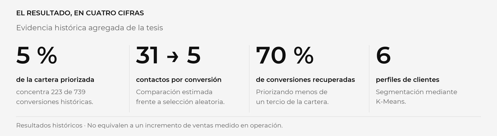

<p align="center"><a href="README.md">English</a> &nbsp;|&nbsp; <strong>Español</strong></p>

<p align="center">
  
</p>

<p align="center">
  <strong>Ingeniería Industrial · Universidad del Valle de Guatemala</strong><br />
  Un caso aplicado de ciencia de datos para orientar el esfuerzo comercial.
</p>

<p align="center">
  <a href="tesis/tesis_publica_anonimizada.pdf"><strong>LEER LA TESIS ↗</strong></a>&nbsp;&nbsp; / &nbsp;&nbsp;
  <a href="docs/CASO_DE_ESTUDIO.md"><strong>EXPLORAR EL CASO ↗</strong></a>&nbsp;&nbsp; / &nbsp;&nbsp;
  <a href="docs/REPRODUCIBILIDAD.md"><strong>PROBAR LA DEMO ↗</strong></a>
</p>

---

## Una pregunta de negocio. Una respuesta analítica.

**¿A quién debería contactar primero un equipo de ventas cuando no puede atender toda su cartera?**

Esta tesis conecta comprensión del proceso comercial, calidad de datos, segmentación y predicción para convertir una base de leads en un criterio de atención. La entrega integra dos salidas en Power BI: **perfil de cliente** y **percentil de prioridad**.



<sub>Las cifras corresponden a universos y puntos de operación específicos del estudio histórico. No representan un aumento de ventas medido tras una implementación. Consulta su contexto y límites en la tesis.</sub>

## De la investigación a una herramienta de trabajo


El proyecto se diseñó alrededor de una decisión concreta: **ordenar la atención comercial**. La segmentación describe perfiles; el modelo predictivo ordena oportunidades; la integración entrega esos resultados en el flujo de trabajo del equipo.

## El dashboard en la práctica


Las ocho pantallas muestran cómo el análisis se convierte en una interfaz de consulta, con etiquetas anonimizadas y una tabla de predicción sintética. [Explorar la galería del dashboard →](docs/DASHBOARD.md)

<sub>Vistas estáticas de resultados agregados. La galería explica el alcance y los denominadores de cada vista.</sub>

## Elige tu recorrido

<table>
  <tr>
    <td width="33%" valign="top">
      <h3>01 / El caso</h3>
      <p>Problema, enfoque, resultados e implicaciones para el negocio.</p>
      <a href="docs/CASO_DE_ESTUDIO.md"><strong>Ver el caso de estudio →</strong></a>
    </td>
    <td width="33%" valign="top">
      <h3>02 / La investigación</h3>
      <p>Documento académico adaptado, metodología y evidencia agregada.</p>
      <a href="tesis/tesis_publica_anonimizada.pdf"><strong>Leer la tesis →</strong></a>
    </td>
    <td width="33%" valign="top">
      <h3>03 / La implementación</h3>
      <p>Código por etapas y demostración reproducible con datos sintéticos.</p>
      <a href="docs/GUIA.md"><strong>Recorrer el código →</strong></a>
    </td>
  </tr>
</table>

## Una publicación que protege la información

**Resultados agregados autorizados. Nombres comerciales generalizados. Demostración sintética.**

La edición pública excluye las bases del CRM, identificadores reales, correspondencias de nombres, exportaciones, archivos `.pbix`, capturas sin anonimizar, figuras originales confidenciales y modelos entrenados con datos reales. El PDF es una **adaptación para portafolio** que omite material visual y anexos confidenciales.

La demo entrena sus propios modelos sobre registros inventados. Sus resultados y segmentos **no corresponden a los modelos históricos de la tesis**.

[Consultar el alcance de la anonimización →](docs/ANONIMIZACION.md)

## Mapa del proyecto

| Etapa | Qué encontrarás | Abrir |
|---|---|---|
| **01 / Preparación** | Armonización, validaciones y limpieza; enriquecimiento comercial retirado | [Limpieza](01%20Limpieza%20C%C3%B3digo/) |
| **02 / Segmentación** | Exploración de K-Means y configuraciones | [K-Means](02%20K%20Means/) |
| **03 / Predicción** | Comparación de modelos y selección | [Predicción](03%20Prediccion/) |
| **04 / Consolidación** | Hilo técnico del estudio y análisis Monte Carlo | [Notebook final](04%20Notebook%20Final/) |
| **05 / Integración** | Paquete de scoring y contrato de entrada/salida | [Power BI](05%20Power%20BI/) |
| **06 / Complementos** | Análisis de colinealidad, sin salidas | [Análisis adicional](06%20Otros/) |
| **Documento** | PDF anonimizado y fuentes LaTeX de esta edición | [Tesis](tesis/) |
| **Demostración** | Generación independiente de datos y modelos sintéticos | [Ejemplos](examples/) |

## Pruébalo con datos ficticios

```bash
python -m pip install -r "05 Power BI/requirements.txt"
python examples/entrenar_demo_sintetica.py
python examples/demo_scoring.py
```

Ejecuta desde la raíz del repositorio, preferiblemente con Python 3.11 en un entorno virtual. La [guía de reproducción](docs/REPRODUCIBILIDAD.md) incluye instalación y pruebas.

**Herramientas** · Python / pandas / NumPy / scikit-learn / SciPy / Jupyter / Power BI / BPMN / LaTeX

---

**Angie Flores** · Ingeniería Industrial · Universidad del Valle de Guatemala · 2026

<details>
<summary>Título académico y autoría</summary>

*Desarrollo y validación de modelos predictivos para la priorización de leads aplicados al proceso comercial de proyectos residenciales de empresas desarrolladoras de vivienda en la Ciudad de Guatemala.*

Edición adaptada para portafolio. La publicación no concede por sí misma una licencia de reutilización del documento, código o recursos de terceros. Las ilustraciones de esta portada son conceptuales y no representan proyectos reales.

</details>
