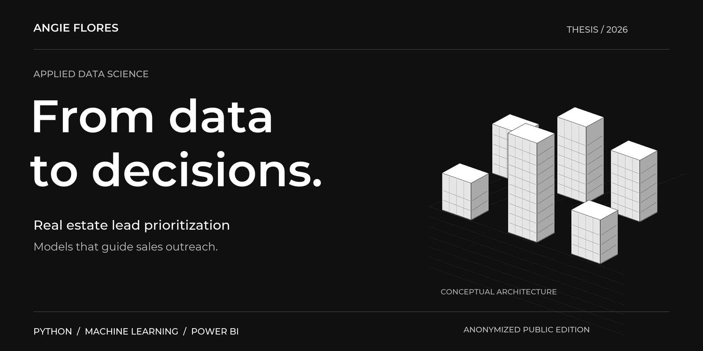
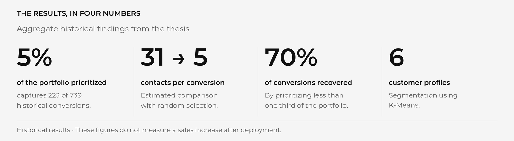
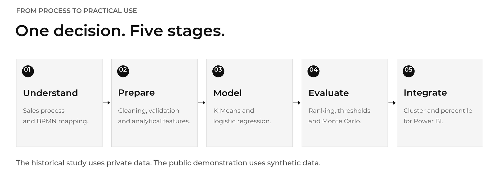
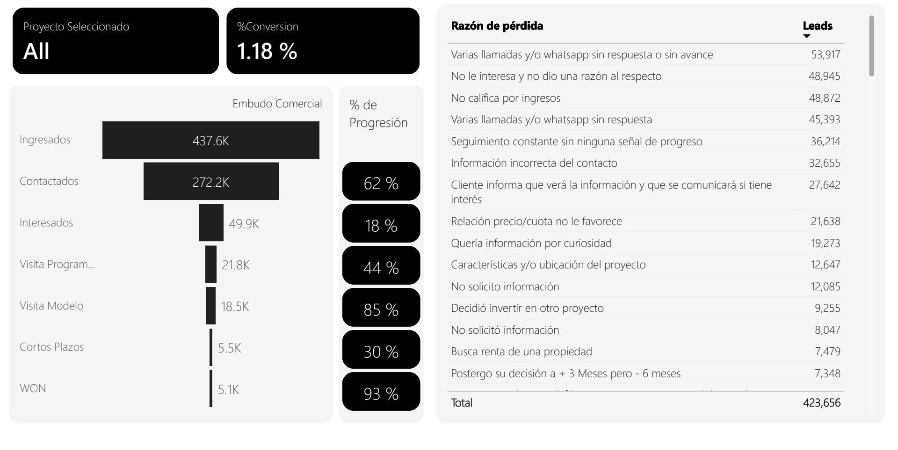

<p align="center"><strong>English</strong> &nbsp;|&nbsp; <a href="README.es.md">Español</a></p>

<p align="center">
  
</p>

<p align="center">
  <strong>Industrial Engineering · Universidad del Valle de Guatemala</strong><br />
  An applied data science case study for guiding sales outreach.
</p>

<p align="center">
  <a href="tesis/tesis_publica_anonimizada.pdf"><strong>READ THE THESIS (ES) ↗</strong></a>&nbsp;&nbsp; / &nbsp;&nbsp;
  <a href="docs/en/CASE_STUDY.md"><strong>EXPLORE THE CASE ↗</strong></a>&nbsp;&nbsp; / &nbsp;&nbsp;
  <a href="docs/en/REPRODUCIBILITY.md"><strong>TRY THE DEMO ↗</strong></a>
</p>

---

## A business question. An analytical answer.

**Who should a sales team contact first when it cannot reach its entire portfolio?**

This thesis connects sales process understanding, data quality, segmentation, and prediction to turn a lead database into a prioritization criterion. The implementation delivers two outputs in Power BI: **customer profile** and **priority percentile**.



<sub>These figures refer to specific analysis populations and operating points in the historical study. They do not represent a sales increase measured after deployment. See the thesis for context and limitations.</sub>

## From research to a practical tool



The project was designed around a specific decision: **prioritizing sales outreach**. Segmentation describes profiles, the predictive model ranks opportunities, and the integration brings both outputs into the team's workflow.

## The dashboard, in practice



All eight screens show how the analysis becomes a readable interface, with anonymized labels and a synthetic prediction table. [Explore the dashboard gallery →](docs/en/DASHBOARD.md)

<sub>Static aggregate views. Original chart labels are in Spanish; English reading notes are provided in the gallery.</sub>

## Choose your path

<table>
  <tr>
    <td width="33%" valign="top">
      <h3>01 / The case</h3>
      <p>The problem, approach, results, and business implications.</p>
      <a href="docs/en/CASE_STUDY.md"><strong>Explore the case study →</strong></a>
    </td>
    <td width="33%" valign="top">
      <h3>02 / The research</h3>
      <p>The adapted academic document, methodology, and aggregate evidence.</p>
      <a href="tesis/tesis_publica_anonimizada.pdf"><strong>Read the thesis (Spanish) →</strong></a>
    </td>
    <td width="33%" valign="top">
      <h3>03 / The implementation</h3>
      <p>Code organized by stage and a reproducible synthetic demonstration.</p>
      <a href="docs/en/READING_GUIDE.md"><strong>Explore the code →</strong></a>
    </td>
  </tr>
</table>

## A publication that protects the data

**Approved aggregate results. Generalized business names. A synthetic demonstration.**

The public edition excludes CRM databases, real identifiers, name mappings, exports, `.pbix` files, unredacted screenshots, confidential original figures, and models trained on real customers. The PDF is a **portfolio adaptation** that omits confidential visual material and appendices.

The demo trains its own models on invented records. Its results and segments **do not correspond to the historical thesis models**.

[Read the anonymization scope →](docs/en/ANONYMIZATION.md)

## Project map

| Stage | What you will find | Open |
|---|---|---|
| **01 / Preparation** | Schema harmonization, validation, and cleaning; commercial enrichment removed | [Data preparation](01%20Limpieza%20C%C3%B3digo/) |
| **02 / Segmentation** | K-Means exploration and configurations | [K-Means](02%20K%20Means/) |
| **03 / Prediction** | Model comparison and selection | [Prediction](03%20Prediccion/) |
| **04 / Consolidation** | The technical research narrative and Monte Carlo analysis | [Final notebook](04%20Notebook%20Final/) |
| **05 / Integration** | Scoring package and input/output contract | [Power BI](05%20Power%20BI/) |
| **06 / Additional analysis** | Collinearity analysis, without stored outputs | [Additional analysis](06%20Otros/) |
| **Document** | Anonymized PDF and LaTeX sources for this edition | [Thesis](tesis/) |
| **Demonstration** | Independent generation of synthetic data and models | [Examples](examples/) |

## Try it with fictional records

```bash
python -m pip install -r "05 Power BI/requirements.txt"
python examples/entrenar_demo_sintetica.py
python examples/demo_scoring.py
```

Run from the repository root, preferably with Python 3.11 in a virtual environment. The [reproducibility guide](docs/en/REPRODUCIBILITY.md) covers installation and checks.

**Tools** · Python / pandas / NumPy / scikit-learn / SciPy / Jupyter / Power BI / BPMN / LaTeX

**Languages** · This portfolio and its reader guides are available in English and Spanish. The academic PDF, notebooks, code comments, and original folder names remain in Spanish.

---

**Angie Flores** · Industrial Engineering · Universidad del Valle de Guatemala · 2026

<details>
<summary>Academic title and authorship</summary>

Original title: *Desarrollo y validación de modelos predictivos para la priorización de leads aplicados al proceso comercial de proyectos residenciales de empresas desarrolladoras de vivienda en la Ciudad de Guatemala.*

English translation: *Development and validation of predictive models for lead prioritization in the sales process of residential projects developed by homebuilding companies in Guatemala City.*

Adapted portfolio edition. Publication alone does not grant a reuse license for the document, code, or third-party resources. The cover illustrations are conceptual and do not depict real projects.

</details>
