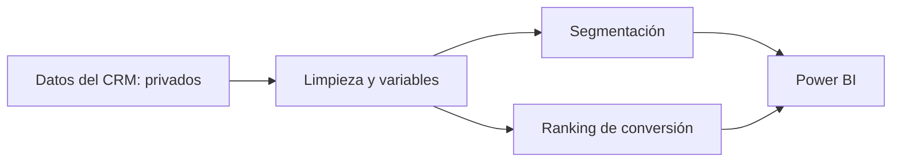

# Priorización de leads inmobiliarios con ciencia de datos

**Angie Flores · Ingeniería Industrial · Universidad del Valle de Guatemala · 2026**

Tesis aplicada sobre cómo orientar la atención comercial mediante limpieza de datos, segmentación de clientes y modelos predictivos.

**[Leer la tesis anonimizada](tesis/tesis_publica_anonimizada.pdf)** · **[Guía del código](docs/GUIA.md)** · **[Ejecutar la demostración](docs/REPRODUCIBILIDAD.md)** · **[Alcance de la anonimización](docs/ANONIMIZACION.md)**

## Problema y solución

El volumen de clientes potenciales puede superar la capacidad de atención del equipo comercial. El proyecto integra documentación BPMN, preparación de datos, K-Means, regresión logística e integración con Power BI para decidir a quién contactar primero.

## Resultados históricos agregados

| Hallazgo de la tesis | Resultado |
|---|---|
| Conversiones concentradas en el 5 % de mayor prioridad | 223 de 739 |
| Contactos estimados por conversión en ese corte | Aproximadamente 5 frente a 31 con selección aleatoria |
| Punto de operación con 70 % de recuperación | Menos de un tercio de la cartera priorizada |
| Segmentación | Seis perfiles de clientes |

Son resultados del análisis histórico, conservados con autorización para esta publicación. No demuestran un aumento de ventas medido en operación. Los universos y límites se explican en la tesis adaptada.

## Contenido

| Carpeta | Contenido |
|---|---|
| [`tesis/`](tesis/) | Edición pública anonimizada y fuentes LaTeX |
| [`01 Limpieza Código/`](01%20Limpieza%20C%C3%B3digo/) | Código de preparación adaptado; enriquecimiento comercial retirado |
| [`02 K Means/`](02%20K%20Means/) | Notebooks de exploración y segmentación, sin salidas |
| [`03 Prediccion/`](03%20Prediccion/) | Notebooks predictivos, sin bases ni modelos históricos |
| [`04 Notebook Final/`](04%20Notebook%20Final/) | Desarrollo consolidado y análisis Monte Carlo |
| [`05 Power BI/`](05%20Power%20BI/) | Paquete de scoring con artefactos sintéticos de demostración |
| [`06 Otros/`](06%20Otros/) | Análisis complementario, sin salidas |
| [`examples/`](examples/) | Generación sintética reproducible y demostración |

## Probar el flujo

La demostración conserva la interfaz `cluster` y `percentil` con modelos entrenados desde cero sobre datos inventados. **No utiliza modelos originales ni reproduce su rendimiento.** Consulta las [instrucciones](docs/REPRODUCIBILIDAD.md).

## Confidencialidad

No se publican registros del CRM, identificadores reales, correspondencias entre nombres, exportaciones, `.pbix`, capturas, figuras originales ni modelos entrenados sobre clientes reales. Los nombres de proyectos y campañas del código se sustituyeron por etiquetas genéricas. La tesis pública omite material visual y anexos internos, y conserva los resultados agregados autorizados.

## Competencias

Python · pandas · NumPy · scikit-learn · SciPy · Jupyter · Power BI · BPMN · LaTeX. Comprensión del negocio, calidad de datos, prevención de fuga de información, evaluación de modelos y entrega de herramientas de apoyo comercial.

## Autoría

Trabajo de graduación de Angie Flores, Universidad del Valle de Guatemala. El título académico original es *Desarrollo y validación de modelos predictivos para la priorización de leads aplicados al proceso comercial de proyectos residenciales de empresas desarrolladoras de vivienda en la Ciudad de Guatemala*.

Edición adaptada para portafolio. La publicación no concede por sí misma una licencia de reutilización del documento, código o recursos de terceros.
