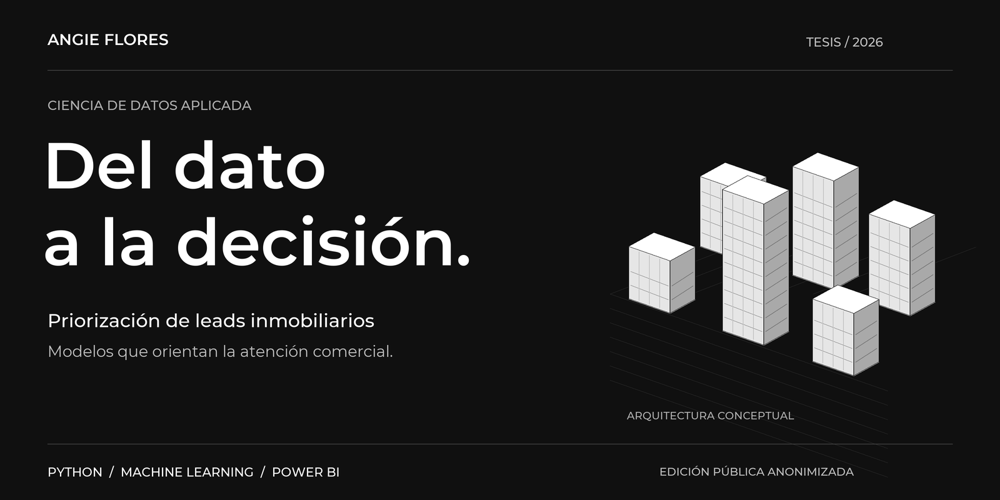
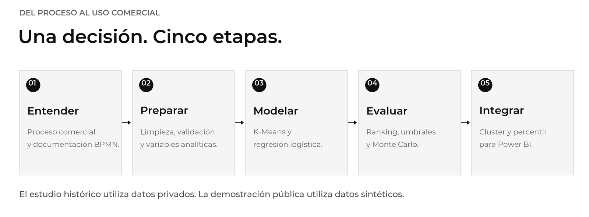
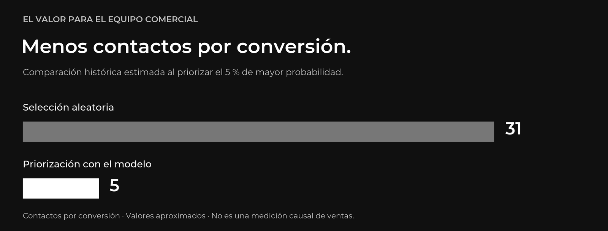

[English](en/CASE_STUDY.md) | **Español** · [Portafolio](../README.es.md)

[← Volver al portafolio](../README.es.md)

# Cuando la capacidad de atención es limitada

Una cartera extensa de clientes potenciales no garantiza que el equipo comercial pueda atender todas las oportunidades. El proyecto estudia cómo establecer un criterio cuantitativo para decidir **a quién contactar primero** en proyectos residenciales de la Ciudad de Guatemala.

## 01 / Comprender antes de modelar

El proceso comercial se documentó con BPMN para ubicar el punto en que la priorización puede apoyar el trabajo del equipo: a partir de la etapa «Interesado», después del contacto y perfilamiento. Esta definición permite distinguir la información disponible a tiempo de las variables que aparecen después del desenlace.

## 02 / Hacer que los datos sirvan a la decisión

La preparación integra exportaciones, armoniza esquemas, normaliza categorías y trata la ausencia de información. El análisis separa predictores de identificadores, controles y variables tardías para reducir el riesgo de fuga de información.

## 03 / Dos modelos con propósitos distintos

| Componente | Pregunta que responde | Entrega |
|---|---|---|
| **Segmentación K-Means** | ¿A qué perfil se parece el lead? | Grupo o `cluster` |
| **Regresión logística** | ¿Qué oportunidades conviene atender primero? | Probabilidad utilizada para calcular un ranking |
| **Integración Power BI** | ¿Cómo presentar el resultado al equipo comercial? | Tabla con `cluster` y `percentil` |

El percentil representa una posición relativa dentro del lote. Un percentil de 85 no significa una probabilidad de compra del 85 %.

## 04 / Evaluar en términos del esfuerzo comercial

En el universo descrito en el resumen de la tesis, el 5 % de mayor prioridad concentra 223 de las 739 conversiones históricas. En ese corte, el esfuerzo estimado es de aproximadamente cinco contactos por conversión, frente a 31 con selección aleatoria.

En otro punto de operación, el modelo recupera el 70 % de las conversiones al priorizar menos de un tercio de la cartera. La segmentación identifica seis perfiles de clientes.

**Estos resultados son históricos.** No constituyen una medición causal de ventas futuras. La tesis recomienda una prueba controlada antes de una adopción generalizada; los universos y criterios de evaluación se documentan en el PDF.

## 05 / Entregar una interfaz utilizable

La integración recibe una tabla, conserva sus filas y columnas originales y agrega `cluster` y `percentil`. La copia pública permite probar ese contrato con modelos y datos sintéticos, generados de forma independiente. No distribuye los modelos originales ni reproduce su rendimiento histórico.

[Ver la galería anonimizada del dashboard →](DASHBOARD.md)

---

**Siguiente paso** · [Leer la tesis anonimizada](../tesis/tesis_publica_anonimizada.pdf) / [Revisar el código](GUIA.md) / [Ejecutar la demostración](REPRODUCIBILIDAD.md)

Identidades comerciales, registros individuales, capturas sin anonimizar y material operativo confidencial quedan fuera de esta edición. Las ilustraciones arquitectónicas son conceptuales. Consulta el [alcance de la anonimización](ANONIMIZACION.md).
