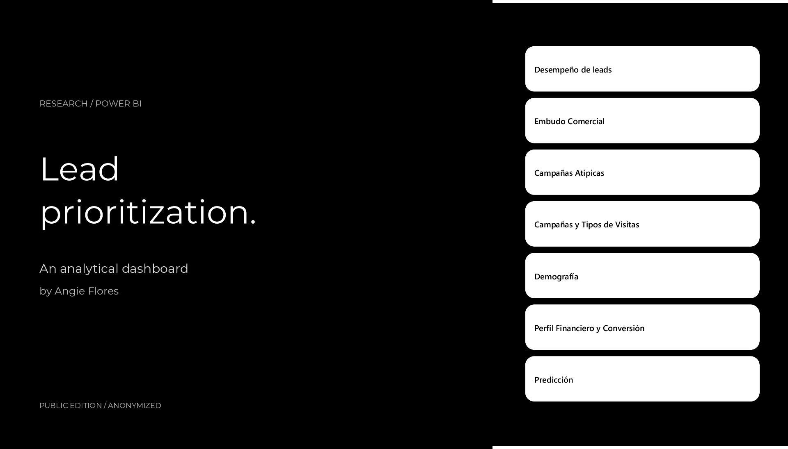
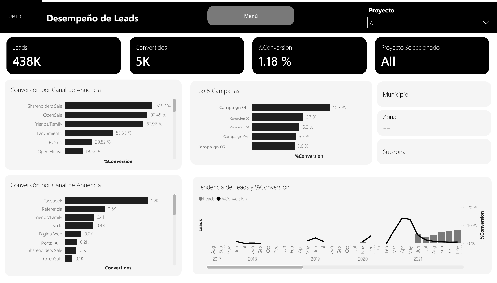
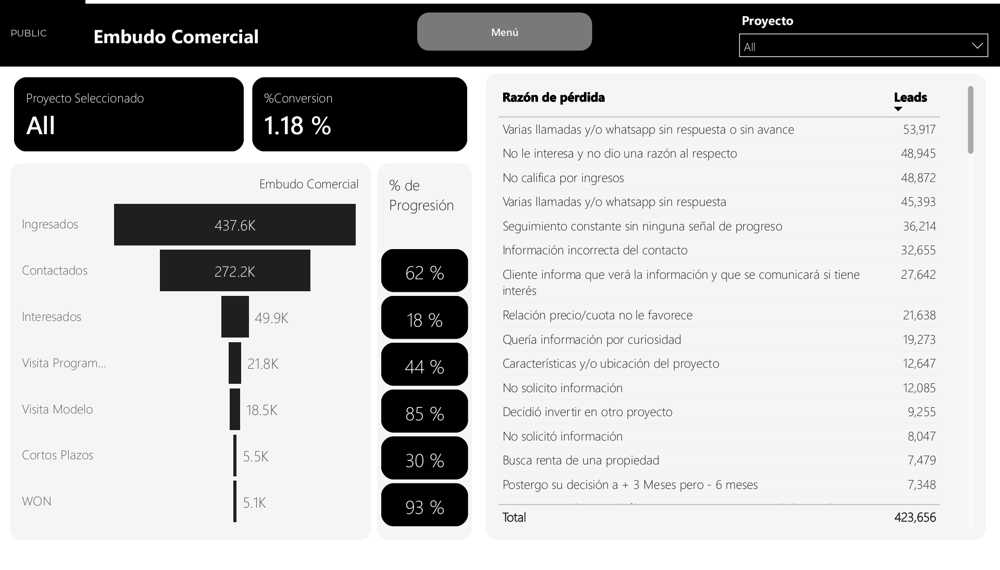
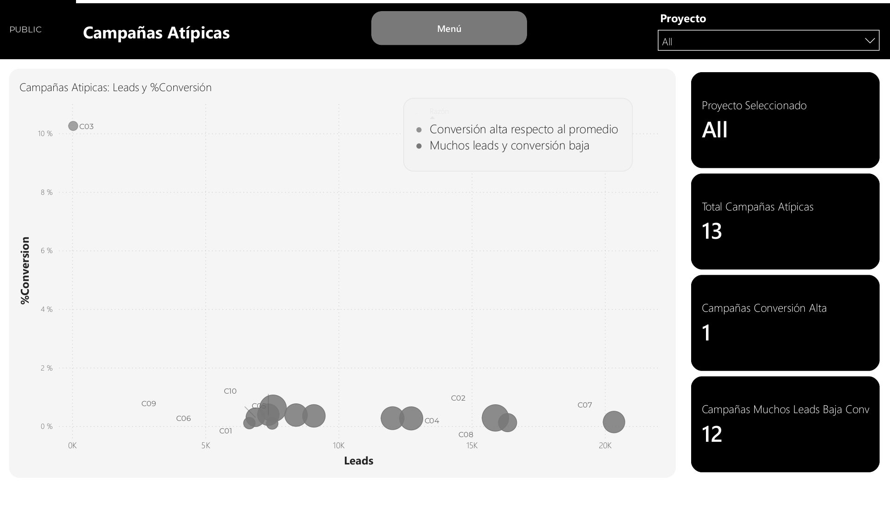
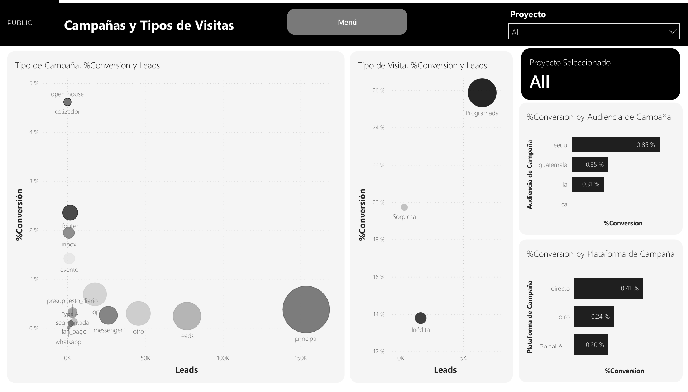
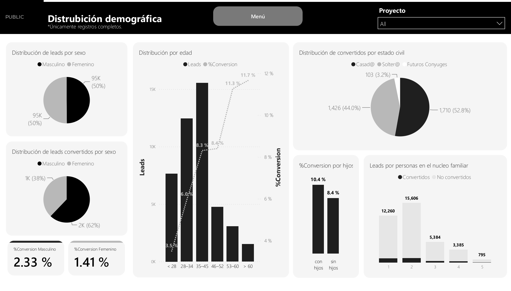
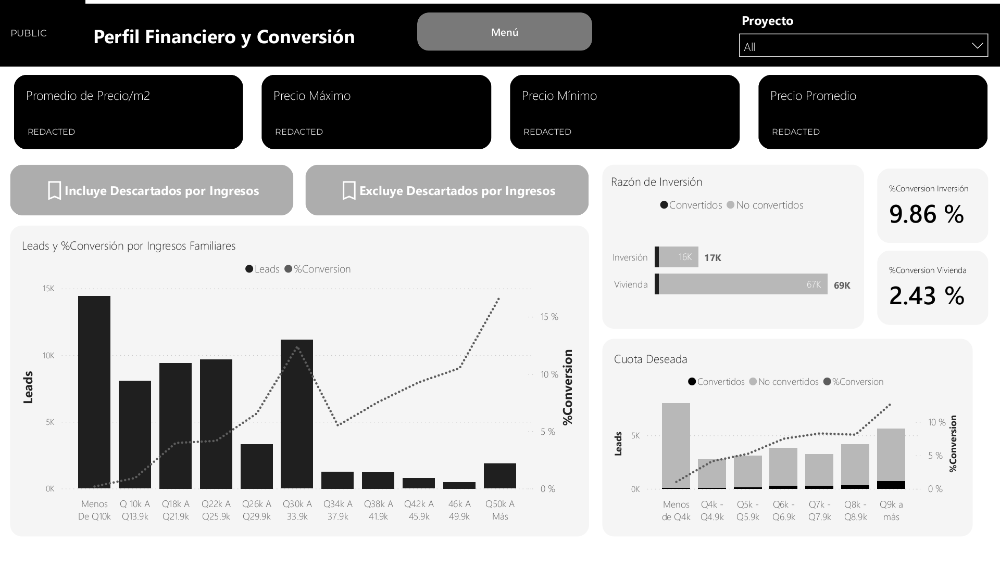
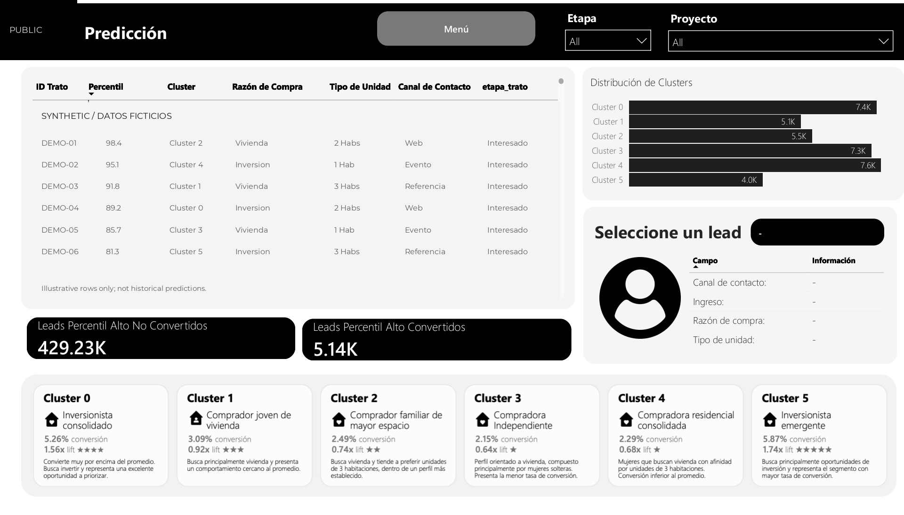

[English](en/DASHBOARD.md) | **Español** · [← Portafolio](../README.es.md)

# Galería completa del dashboard

Las ocho pantallas del dashboard, adaptadas para publicación. Se conservan las distribuciones y los gráficos agregados en una edición en blanco y negro; se retiran o sustituyen la marca y las etiquetas identificables. La tabla de predicción utiliza ejemplos ficticios.

[Descargar el PDF público de ocho páginas →](dashboard/dashboard-public.pdf)

Son capturas estáticas, no una aplicación Power BI en vivo. Los menús y filtros de las imágenes no son interactivos.

## 01 / Navegación

Se conserva la disposición original del menú. La fotografía del edificio comercial y la identidad de la empresa se sustituyen por una portada neutra con Montserrat.

## 02 / Desempeño de leads

Conversión agregada por canal, campaña y período. Los nombres de campañas y portales son etiquetas genéricas locales a cada vista, sin correspondencias publicadas con entidades reales.

## 03 / Embudo comercial

La conversión global y la progresión entre etapas sucesivas utilizan distintos denominadores. K representa miles redondeados. Las razones de pérdida son categorías agregadas, no notas de clientes.

## 04 / Campañas atípicas

El volumen y la conversión permiten identificar campañas atípicas. Se sustituyen las etiquetas identificables, incluido un nombre de corredor; se conservan las posiciones y tamaños de las burbujas.

## 05 / Campañas y tipos de visitas

Las categorías de campaña y visita relacionan la captación con la conversión. Se generalizan las etiquetas que identifican a la empresa y a un portal.

## 06 / Demografía

Solo subconjuntos de registros completos. La disponibilidad varía según el campo, por lo que los gráficos pueden tener distintos denominadores; sus cantidades no deben sumarse ni interpretarse como la totalidad del CRM. Las asociaciones no demuestran causalidad.

## 07 / Perfil financiero y conversión

Bandas de ingresos, cuota deseada y propósito de compra agregados. Se ocultan los valores de las cuatro tarjetas de precios comerciales. Estas asociaciones históricas no determinan elegibilidad ni resultados individuales futuros.

## 08 / Interfaz de predicción

La tabla completa de registros se reemplaza por seis ejemplos inventados, marcados SYNTHETIC / DATOS FICTICIOS. Sus identificadores, percentiles, perfiles, canales y etapas son ilustrativos y no son salidas del modelo. Los paneles agregados de alrededor conservan la captura de origen. Las etiquetas y tasas de los clusters corresponden a esa iteración del dashboard y no deben equipararse con la segmentación final de la tesis; consulta el documento para los resultados finales.

## Alcance de la publicación

No se distribuyen los adjuntos originales, filas ni predicciones de clientes reales, el logo, nombres comerciales, valores de precios comerciales, la fotografía del edificio, recursos incrustados ni notas de origen. Los PNG y el PDF aplanado contienen únicamente las vistas públicas revisadas; el PDF no conserva los textos u objetos originales debajo de los elementos ocultos.

La galería documenta una interfaz analítica histórica, no un impacto medido en producción. [Explora el caso de estudio](CASO_DE_ESTUDIO.md) o [ejecuta la demo independiente de scoring sintético](REPRODUCIBILIDAD.md).
