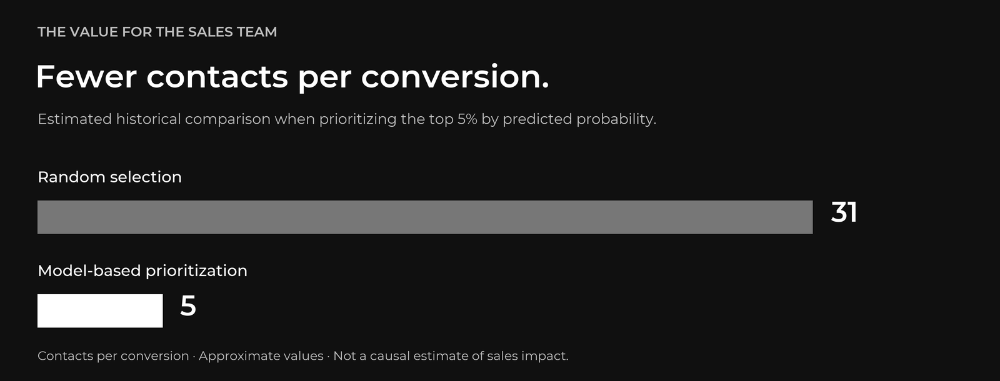

[← Portfolio](../../README.md) · **English** | [Español](../CASO_DE_ESTUDIO.md)

# When outreach capacity is limited

A large portfolio of potential customers does not guarantee that a sales team can reach every opportunity. This project studies how to establish a quantitative criterion for deciding **who to contact first** in residential projects in Guatemala City.

## 01 / Understand before modeling

The sales process was documented using BPMN to identify where prioritization could support the team: starting at the “Interested” stage, after initial contact and profiling. This definition helps separate information available at the time of the decision from variables recorded after the outcome.

## 02 / Make the data serve the decision

Data preparation integrates exports, harmonizes schemas, normalizes categories, and handles missing information. The analysis separates predictors from identifiers, control fields, and late-stage variables to reduce the risk of data leakage.

## 03 / Two models with different purposes

| Component | Question it answers | Output |
|---|---|---|
| **K-Means segmentation** | Which profile does the lead resemble? | Group or `cluster` |
| **Logistic regression** | Which opportunities should be contacted first? | Probability used to calculate a ranking |
| **Power BI integration** | How can the results be presented to the sales team? | Table with `cluster` and `percentil` |

The percentile is a relative position within the processed batch. A percentile of 85 does not mean an 85% probability of purchase. The API column name remains `percentil` in both language versions.

## 04 / Evaluate sales effort

In the population described in the thesis abstract, the top 5% captures 223 of 739 historical conversions. At that cutoff, estimated effort is approximately five contacts per conversion, compared with 31 under random selection.

At another operating point, the model recovers 70% of conversions by prioritizing less than one third of the portfolio. Segmentation identifies six customer profiles.

**These are historical results.** They are not a causal estimate of future sales. The thesis recommends a controlled trial before widespread adoption; analysis populations and evaluation criteria are documented in the Spanish PDF.

## 05 / Deliver a usable interface

The integration receives a table, preserves its original rows and columns, and adds `cluster` and `percentil`. The public edition lets readers try that contract with independently generated synthetic data and models. It does not distribute the original models or reproduce their historical performance.

[View the anonymized dashboard gallery →](DASHBOARD.md)

---

**Next step** · [Read the anonymized thesis (Spanish)](../../tesis/tesis_publica_anonimizada.pdf) / [Explore the code](READING_GUIDE.md) / [Run the demonstration](REPRODUCIBILITY.md)

Business identities, individual records, unredacted screenshots, and confidential operational material are excluded. Architectural illustrations are conceptual. See the [anonymization scope](ANONYMIZATION.md).
