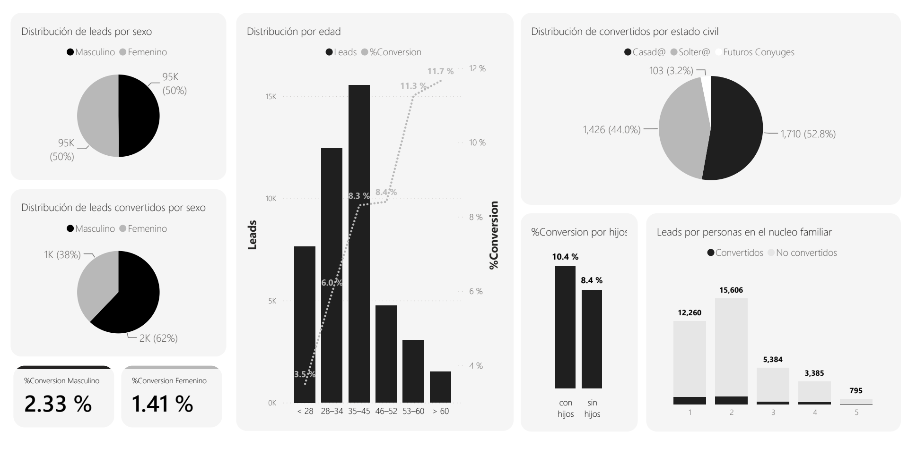

[← Portfolio](../../README.md) · **English** | [Español](../DASHBOARD.md)

# Inside the dashboard

Two views of the Power BI analytical interface, selected for this public portfolio. Both show historical aggregate results. The company header and logo have been removed from the rendered images; chart values have been preserved.

## 01 / The sales funnel

From initial entry to conversion, the funnel makes the scale of the portfolio and the drop between stages visible. Progression percentages refer to successive stages; the overall conversion rate uses the full portfolio. The loss-reason table describes aggregate categories rather than individual customer notes.

**Reading the view:** “Ingresados” = entered; “Contactados” = contacted; “Interesados” = interested; “Visita Program…” = scheduled visit; “Visita Modelo” = model-unit visit; “Cortos Plazos” = short-term opportunities; “WON” = converted. “Razón de pérdida” = loss reason. Values abbreviated with K are rounded thousands.

## 02 / Demographic exploration

The second view compares aggregate distributions and conversion rates by recorded demographic attributes. It documents exploratory analysis, with no customer records or individual predictions.

**Scope:** these visuals use complete-record subsets. Availability differs by field, so charts can have different denominators; their counts must not be added together or treated as the full CRM population. Observed associations do not establish causation or future individual outcomes.

**Reading the view:** “sexo” = sex; “edad” = age; “estado civil” = marital status; “con hijos / sin hijos” = with / without children; “núcleo familiar” = household; “convertidos / no convertidos” = converted / not converted. Original chart labels remain in Spanish.

## What this gallery demonstrates

The dashboard connects descriptive exploration with the thesis workflow. The scoring integration described in the [case study](CASE_STUDY.md) adds a customer profile (`cluster`) and a relative priority (`percentil`). The public gallery omits the prediction screen because it contains record-level identifiers and scores.

These are static historical views, not a live dashboard or evidence of a production rollout. The source presentation was used as research context; the original deck, screenshots PDF, embedded resources, and notes are not distributed. The [synthetic demonstration](REPRODUCIBILITY.md) lets readers explore the scoring contract without real customer data.
